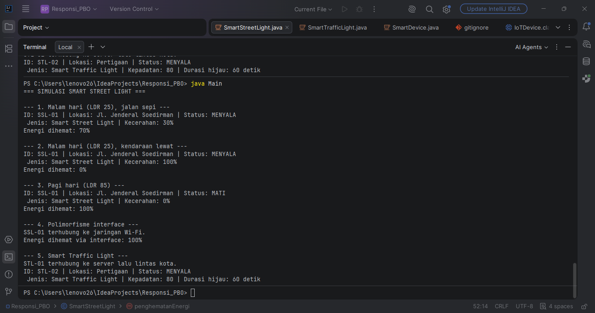

# Responsi PBO

**Nama:** Nisrina Nazihah Syarif |
**NIM:** H1D025114 |
**Tema Sistem:** IoT (Smart Street Light)

## Deskripsi Sistem
Lampu jalan menyala otomatis saat gelap (LDR < 50). Jika ada orang atau kendaraan lewat, lampu menyala terang (100%). Jika tidak ada, lampu menyala redup (30%) untuk menghemat energi. Saat siang hari (terang), lampu mati.

## Cara Compile dan Run melalui Terminal
1. Buka Terminal atau CMD
2. Arahkan direktori (cd) ke folder yang berisi file java
3. Compile seluruh file java:
   ```bash
   javac *.java
   ```
4. Jalankan program:
   ```bash
   java Main
   ```
## Screenshot Output
